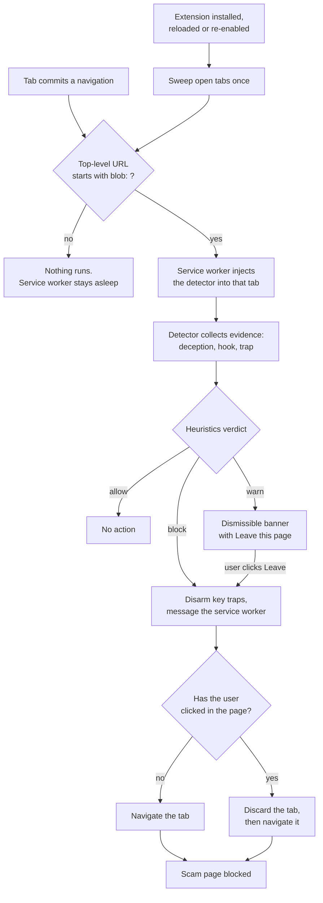

# Detection note

**In short.** The extension inspects only top-level `blob:` documents, because showing content without a scannable URL is the scam's defining trick. It scores three kinds of evidence: deceptive wording, a phone number to call, and trapping behaviour. It redirects the tab only when the page both claims the device is locked or infected and traps the user; any other two kinds agreeing get a dismissible banner. That split exists because a legitimate preview, invoice or editor shares any one of those traits with the scam, and being wrong about a redirect destroys the user's page. The main risks are a legitimate blob page that both talks like a scam and traps the user (false positive), and a scam that hides its content in an iframe, paints it later than 15 seconds, or uses wording outside the English patterns (false negatives).

## How the attack is detected

**1. Gate: is this a top-level `blob:` document?**
The scam never navigates to a scannable URL; it builds the lock screen in memory and shows it from a `blob:` URL. So that is the only place the extension looks. The service worker listens for top-level navigations whose URL starts with `blob:` and injects the detector into just those tabs. Being a blob is the trigger for looking, never the verdict: `benign.html` is a blob too.

**2. Evidence, of three independent kinds**

| Kind | Signals (weight) |
|---|---|
| Deception | claims the device is locked / infected / at risk (2), poses as an OS or security vendor (2), made-up error code (1) |
| Hook | a phone number with "call / contact / support" wording next to it (3) |
| Trap | cancels F5 / F11 / F12 (3), locks keyboard or pointer (3), `beforeunload` (2), fullscreen (2), cancels right-click (1), Back-button tampering (1) |
| Provenance | the blob replaced the tab by script, with no user gesture (1) |

Trap evidence is gathered in three layers, least intrusive first:

1. **Static**: read the blob's own inline scripts. Works on a page that was already open at install time.
2. **Passive**: when the user presses F5 / F11 / F12 or right-clicks, check afterwards whether the page cancelled it.
3. **Probe**: dispatch synthetic F5 / F11 / F12 and see if the page cancels them. Only done on a page that already claims the device is locked or infected, so an ordinary page is never poked.

**3. Verdict**

| Verdict | Rule | Action |
|---|---|---|
| Block | the page claims the device is locked or infected **and** it is trapping (trap score of 3 or more) **and** the total is 6 or more | navigate the tab to the extension's warning page |
| Warn | score of 5 or more with two kinds, or heavy trapping alone (trap score of 6 or more) | dismissible banner with a "Leave this page" button |
| Allow | anything else | nothing at all |

`malicious.html` scores 15 with all three kinds. `benign.html` scores 0.

**4. Getting the user out**
The detector first neutralises the page's key and right-click handlers, then the service worker moves the tab. Nothing a page does can block the tabs API, with one exception: a `beforeunload` handler can answer a navigation with "Leave site?" once the user has clicked in the page. In that case the worker discards the tab (which drops the document without running its unload handlers) and loads the warning page in its place, so no prompt ever appears.

## Why this approach

- **One kind of evidence is ordinary.** An invoice has a vendor name and a support number. An editor has an unsaved-changes prompt and its own right-click menu. An antivirus report says a threat was detected. None of those may be touched, and each is a test case, so nothing is shown until two kinds agree.
- **The cost of being wrong decides the response.** Navigating away from a legitimate page destroys the user's work, so that needs the lock claim itself as well as trapping. A document that only quotes a scam, however closely, gets a banner the user can dismiss. So does an editor holding a letter with a phone number: it traps like a scam and has a hook, but makes no claim.
- **Narrow definitions of "trap".** Only F5, F11 and F12 count as escape keys, because editors and terminals bind Ctrl+L, Ctrl+R and Escape for ordinary reasons. A vendor name counts as deception only when the page also traps the user, and then only towards the banner.
- **Performance by not running.** There is no content script on ordinary pages and the service worker is not woken by ordinary navigations (a test asserts both). On a blob document the work is one text read and a few regexes: about 40 ms on a 20,000-row generated report, which is read through a bounded walk rather than in full.
- **Layers instead of one clever trick.** Each trap-detection layer covers the previous one's blind spot: obfuscated scripts defeat the static read but not the probe; a page that ignores synthetic events defeats the probe but not the user's own key press.

## Known risks

**False positives**
- A blob document that *both* makes the lock claim *and* traps the user is blocked: a phishing-awareness simulator, or an editor (with an exit prompt and its own right-click menu) holding an article that quotes a scam. This is the one case that costs the user their page.
- Trapping plus ordinary content gets the banner: that same editor holding a letter with a phone number, or an app that handles F5 / F11 / F12 and prints a support line.
- A genuine security notice ("we noticed unusual activity, call us on ...") uses the scam's wording and gets the banner.
- The static script read is coarse: a key listener, the text `'F11'` and a `preventDefault()` anywhere in the page's scripts count as cancelling escape keys.
- A document that quotes scare wording and prints a phone number gets the banner, not a redirect: a long security article (`samples/extra/edge-security-article.html`), a short awareness leaflet (`samples/extra/edge-security-leaflet.html`) or a help-desk ticket.
- A blob-hosted game or kiosk using fullscreen + keyboard lock + an exit prompt gets the banner.
- A long hyphenated order number next to "contact support" is read as a phone number. On its own that never triggers anything.

**False negatives**
- **Content inside an iframe of the blob document is not inspected.** Wrapping the same lock screen in a full-viewport iframe evades detection entirely. Left out on purpose: it needs multi-frame inspection (see "related techniques" below).
- **The page is watched for 15 seconds after load.** A lock screen painted later is examined only when the user presses F5 / F11 / F12, right-clicks, or the page goes fullscreen.
- Wording outside the English patterns, or wording I did not anticipate. Without a recognised lock or infection claim there is no redirect, however much the page traps; a phone number plus trapping, or heavy trapping alone, still earns the banner.
- A lock screen whose text cannot be read (drawn as an image or canvas, or placed in a shadow root) gets the banner at most (`malicious-image-only.html`).
- The banner lives in the page's own DOM, so a page written against this extension could remove or cover it. Only the redirect is out of the page's reach.
- A scam with no phone number and no trapping, for example "download this cleaner", is outside what this detects.
- A text-only scam with a phone number gets a warning rather than automatic navigation. This preserves legitimate documents that quote scam wording, even when they are short and non-scrolling.
- Scripts loaded from an external URL are not read; the probe and passive layers still apply.
- In an SVG document a redirect works, but the banner cannot be drawn, so warn-level cases there show nothing.
- A page that spams `alert()` in a tight loop keeps the renderer busy, so the detector cannot run. Chrome's own dialog throttling is the only mitigation there.
- A blob created by a `file://` page can only be inspected if "Allow access to file URLs" is on. When it is off the toolbar icon shows a `!` on that tab instead of failing silently.

## Bonus: further trapping layers

`samples/extra/malicious-layered.html` adds a blob-to-blob hop, a capture-phase `beforeunload`, a flooded history with a `popstate` trap, fullscreen with keyboard lock, and a hidden cursor. It is caught because:

- every new blob document is inspected, so the hop gains nothing;
- fullscreen, keyboard/pointer lock and history tampering are signals in their own right;
- the escape is driven from the service worker, which the page cannot reach, and uses tab discard when a prompt is possible;
- the banner is shown in the browser's top layer and re-raised on fullscreen changes, so it stays visible.

Late-painted content (`malicious-delayed.html`), existing content revealed by changing `hidden`, `class` or `style` (`malicious-attribute-reveal.html`), and a page that rewrites itself with `document.write()` are covered by a 15-second mutation watch on the document node. A script tag that deletes itself after running is covered by remembering what was seen.

## Bonus: related techniques (not implemented)

The same idea, "content shown without a scannable URL of its own", has other carriers:

- a `blob:`, `data:` or `srcdoc` **iframe covering the viewport**, either of an innocent-looking page or inside the blob document itself (today's main blind spot);
- `about:blank` plus `document.write`, or a `javascript:` URL document;
- `data:` documents opened in a new window;
- a service worker that synthesises the response, so the URL looks normal but was never served;
- `history.pushState` used to mask the address after load.

To extend: widen the gate from "top-level `blob:`" to "any document whose content did not come from the network at its displayed URL". Concretely, inject into `about:` / `data:` / `blob:` / `srcdoc` frames as well (`all_frames` with `match_origin_as_fallback`) and only score frames that cover most of the viewport. The scoring stage is unchanged, because it never depended on how the content arrived. For normally served pages, the trap signals alone could drive the banner tier.
