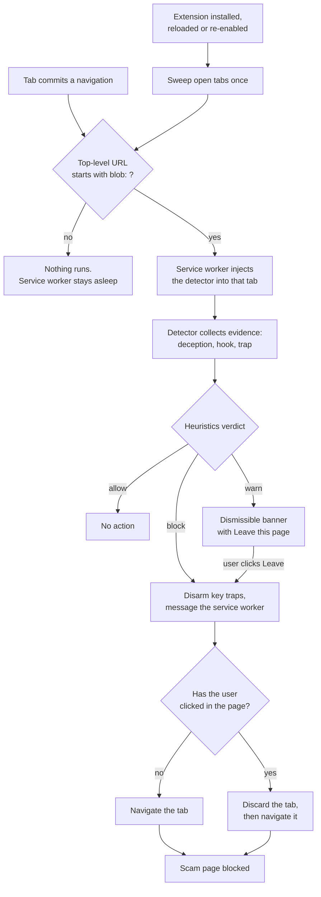

# Detection note

## How the attack is detected

**1. Gate: is this a top-level `blob:` document?**
The scam never navigates to a scannable URL; it builds the lock screen in memory and shows it from a `blob:` URL. So that is the only place the extension looks. The service worker listens for top-level navigations whose URL starts with `blob:` and injects the detector into just those tabs. Being a blob is the trigger for looking, never the verdict: `benign.html` is a blob too.

**2. Evidence, of three independent kinds**

| Kind | Signals (weight) |
|---|---|
| Deception | claims the device is locked / infected / at risk (2), poses as an OS or security vendor (2), made-up error code (1) |
| Hook | a phone number with "call / contact / support" wording next to it (3) |
| Trap | cancels reload / fullscreen / devtools keys (3), locks keyboard or pointer (3), `beforeunload` (2), fullscreen (2), cancels right-click (1), Back-button tampering (1) |
| Provenance | the blob replaced the tab by script, with no user gesture (1) |

Trap evidence is gathered in three layers, least intrusive first:

1. **Static** – read the blob's own inline scripts. Works on a page that was already open at install time.
2. **Passive** – when the user presses F5 / Ctrl+W / right-clicks, check afterwards whether the page cancelled it.
3. **Probe** – dispatch synthetic F5 / F11 / F12 and see if the page cancels them. Only done when the text is already suspicious, so a clean page is never poked.

**3. Verdict**

| Verdict | Rule | Action |
|---|---|---|
| Block | score ≥ 6 **and** two kinds agree **and** (it traps the user, or it looks like a lock screen: terse and non-scrolling) | navigate the tab to the extension's warning page |
| Warn | score ≥ 5 with two kinds, or heavy trapping alone (trap score ≥ 6) | dismissible banner with a "Leave this page" button |
| Allow | anything else | nothing at all |

`malicious.html` scores 15 with all three kinds. `benign.html` scores 0.

**4. Getting the user out**
The detector first neutralises the page's key and right-click handlers, then the service worker moves the tab. Nothing a page does can block the tabs API, with one exception: a `beforeunload` handler can answer a navigation with "Leave site?" once the user has clicked in the page. In that case the worker discards the tab (which drops the document without running its unload handlers) and loads the warning page in its place, so no prompt ever appears.

## Why this approach

- **One kind of evidence is ordinary; two together are not.** An invoice has a vendor name and a support number. An editor has an unsaved-changes prompt and its own right-click menu. A security article quotes "your computer has been locked". None of those may be touched, and each is a test case. Requiring two kinds to agree is what separates them from the scam.
- **The cost of being wrong decides the response.** Navigating away from a legitimate page destroys the user's work, so that needs content and behaviour to agree. Anything weaker gets a banner the user can dismiss.
- **Performance by not running.** There is no content script on ordinary pages and the service worker is not woken by ordinary navigations (a test asserts both). On a blob document the work is one text read and a few regexes: 18 ms on a 20,000-row generated report, with a cap for larger documents.
- **Layers instead of one clever trick.** Each trap-detection layer covers the previous one's blind spot: obfuscated scripts defeat the static read but not the probe; a page that ignores synthetic events defeats the probe but not the user's own key press.

## Known risks

**False positives**
- A blob document that *both* talks like a scam *and* traps the user, such as a phishing-awareness simulator, is blocked.
- A long security article in a blob that quotes scare wording and prints a helpline gets the banner (not a redirect). `samples/extra/edge-security-article.html` shows this.
- A blob-hosted game or kiosk using fullscreen + keyboard lock + an exit prompt gets the banner.

**False negatives**
- Wording outside the English patterns, or wording I did not anticipate. Traps still earn the banner.
- A lock screen drawn entirely as an image or canvas gets the banner rather than a block, because behaviour alone is not proof (`malicious-image-only.html`).
- A scam with no phone number and no trapping, for example "download this cleaner", is outside what this detects.
- Scripts loaded from an external URL are not read; the probe and passive layers still apply.
- A page that spams `alert()` in a tight loop keeps the renderer busy, so the detector cannot run. Chrome's own dialog throttling is the only mitigation there.
- A blob created by a `file://` page can only be inspected if "Allow access to file URLs" is on. When it is off the toolbar icon shows a `!` on that tab instead of failing silently.

## Bonus: further trapping layers

`samples/extra/malicious-layered.html` adds a blob-to-blob hop, a capture-phase `beforeunload`, a flooded history with a `popstate` trap, fullscreen with keyboard lock, and a hidden cursor. It is caught because:

- every new blob document is inspected, so the hop gains nothing;
- fullscreen, keyboard/pointer lock and history tampering are signals in their own right;
- the escape is driven from the service worker, which the page cannot reach, and uses tab discard when a prompt is possible;
- the banner is shown in the browser's top layer and re-raised on fullscreen changes, so it stays visible.

Late-painted content (`malicious-delayed.html`) is covered by a 15-second mutation watch, and a script tag that deletes itself after running is covered by remembering what was seen.

## Bonus: related techniques (not implemented)

The same idea, "content shown without a scannable URL of its own", has other carriers:

- a `blob:`, `data:` or `srcdoc` **iframe covering the viewport** of an innocent-looking page;
- `about:blank` plus `document.write`, or a `javascript:` URL document;
- `data:` documents opened in a new window;
- a service worker that synthesises the response, so the URL looks normal but was never served;
- `history.pushState` used to mask the address after load.

To extend: widen the gate from "top-level `blob:`" to "any document whose content did not come from the network at its displayed URL". Concretely, inject into `about:` / `data:` / `blob:` / `srcdoc` frames as well (`all_frames` with `match_origin_as_fallback`) and only score frames that cover most of the viewport. The scoring stage is unchanged, because it never depended on how the content arrived. For normally served pages, the trap signals alone could drive the banner tier.
